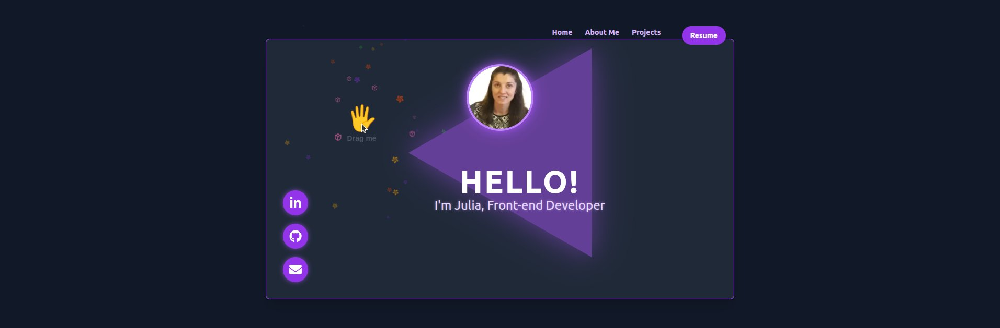

<h1 align="center">Hi 👋, I'm Julia.</h1>
<h3 align="center">A passionate frontend developer from Sofia, Bulgaria.</h3>

  

<h3 align="left">Languages and Tools:</h3>

  <h3>Frontend</h3>
  
  
  
  
  
  
  
  

  <h3>Mobile</h3>
  
  
  

  <h3>State &amp; Data</h3>
  
  
  
  
  
  

  <h3>Forms &amp; Validation</h3>
  
  

  <h3>Backend &amp; Data</h3>
  
  
  
  
  
  
  

  <h3>Real-Time</h3>
  
  
  

  <h3>Testing &amp; Delivery</h3>
  
  
  
  
  
  
  

  <h3>Other</h3>
  
  

<h3 align="center">Connect with me:</h3>

    
    

